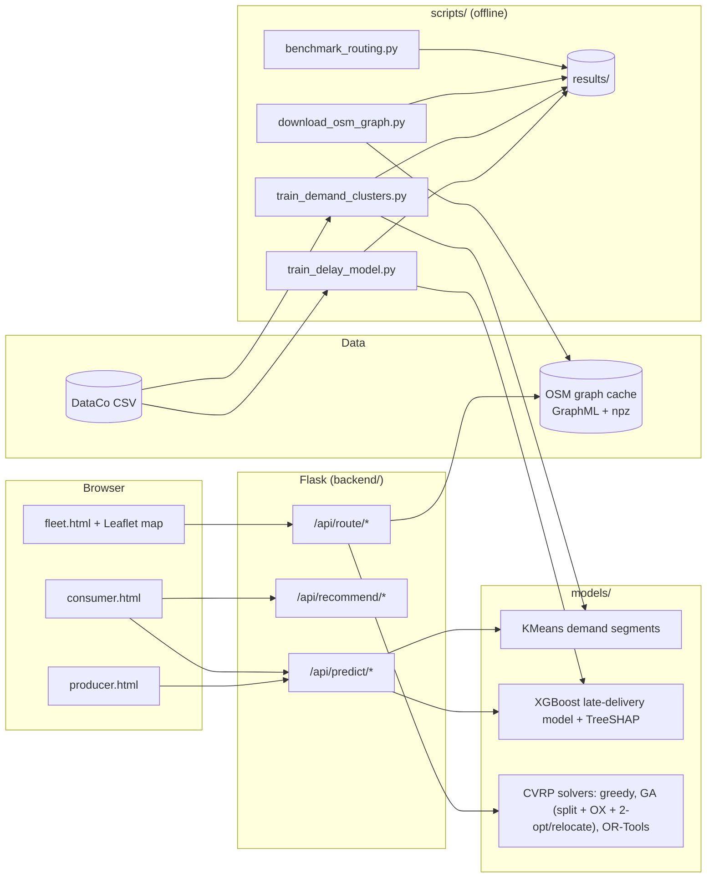

# epoch — Supply Chain Intelligence Platform

A Flask app with three portals on the public DataCo supply-chain dataset and a
Bangalore road network:

* **Fleet Optimizer**: capacitated vehicle routing (CVRP) from a depot, solved
  with greedy nearest neighbour, a genetic algorithm and Google OR-Tools, on
  OpenStreetMap road distances, and benchmarked on random Bangalore instances
  and CVRPLIB.
* **Consumer**: a leakage-free model of whether a new order will ship later
  than promised, evaluated on a time-based split against honest baselines,
  with SHAP explanations.
* **Producer**: KMeans demand segments of product × city pairs (k chosen by
  silhouette) plus descriptive demand/profit analytics.

Every number in this README is copied from a file in [`results/`](results/)
that a script generated. Fuel and CO₂ figures are labelled estimates.

---

## Quick start

Requires **Python 3.11** (the pinned pandas/numpy/scikit-learn have no 3.13 wheels).

```bash
python setup_env.py            # creates .venv (Python 3.11), installs requirements, creates config/config.yaml
```

Get the dataset: download **"DataCo SMART SUPPLY CHAIN FOR BIG DATA ANALYSIS"**
from Kaggle (or Mendeley Data) and put `DataCoSupplyChainDataset.csv`
(latin-1 encoded) in `data/raw/`. Data files are gitignored.

```bash
.venv\Scripts\python scripts/train_delay_model.py        # ~30 s  -> saved_models/delay_model.joblib, results/delay_model_*
.venv\Scripts\python scripts/train_demand_clusters.py    # ~40 s  -> saved_models/demand_kmeans.joblib, results/demand_clustering_metrics.json
.venv\Scripts\python scripts/download_osm_graph.py       # once, ~4 min download; optional (see "fallback mode")
python start_app.py                                      # http://localhost:5000
.venv\Scripts\python -m pytest                           # offline test suite
.venv\Scripts\python scripts/benchmark_routing.py        # full routing benchmark, ~1.5-2 h
```

If `.venv` was created with another Python version: `python setup_env.py --recreate`.
The landing page shows which trained artifacts are present (`/api/health`).

---

## Architecture



More detail: [PROJECT_CONTEXT.md](PROJECT_CONTEXT.md). What changed and why:
[docs/CHANGELOG_NOTES.md](docs/CHANGELOG_NOTES.md).

---

## Results

### Fleet Optimizer: routing benchmark

Source: [`results/routing_benchmark.md`](results/routing_benchmark.md) (raw rows in
`routing_benchmark.csv`, aggregates in `routing_benchmark_summary.json`), generated by
`scripts/benchmark_routing.py`. GA hyperparameters were tuned on seeds 1000-1009
([`results/ga_tuning.csv`](results/ga_tuning.csv),
[`results/ga_tuned_params.json`](results/ga_tuned_params.json)) and frozen before
evaluation on seeds 0-29. "GA, no greedy seed" is an ablation: the GA's initial
population does not contain the greedy solution.

<!-- ROUTING_TABLES -->

### Consumer: late-delivery model

Source: [`results/delay_model_metrics.json`](results/delay_model_metrics.json),
[`results/delay_model_calibration.png`](results/delay_model_calibration.png),
generated by `scripts/train_delay_model.py`. Time-based split: train on orders
from 2015-01-01 to 2017-01-07 (120,934 rows), validate on the next 17,277,
test on the newest 34,554 (2017-04-22 to 2018-01-31). Canceled orders (7,754)
are excluded because they never shipped.

| Model (test set) | ROC-AUC | PR-AUC | F1 |
|---|---:|---:|---:|
| Majority class (always "late") | 0.500 | 0.573 | 0.728 |
| Shipping-mode lookup (train late rate per mode) | 0.744 | 0.785 | 0.691 |
| Logistic regression | 0.748 | 0.838 | 0.728 |
| **XGBoost** | **0.777** | **0.857** | **0.740** |

F1 uses the threshold that maximised F1 on validation (XGBoost: 0.346).

**Honest assessment: the model adds little beyond the shipping mode.** It
beats a one-feature lookup by 0.033 ROC-AUC, and on F1 it barely beats
predicting "late" for every order. Splitting the test set by shipping mode
shows why:

| Shipping mode (test) | Orders | Late rate | XGBoost ROC-AUC within mode |
|---|---:|---:|---:|
| First Class | 5,273 | 100 % | n/a (single class) |
| Same Day | 1,865 | 52.9 % | 1.00 |
| Second Class | 6,742 | 79.8 % | 0.50 |
| Standard Class | 20,674 | 39.5 % | 0.51 |

In this (synthetic) dataset, First Class orders that shipped were always
late, and Same Day orders were late exactly when placed at or after 12:00
(0 % late before noon, 100 % after). The model learns those two rules. For
Second and Standard Class, 79 % of test orders, it is at chance level:
none of the order-time features carries signal. The model is well calibrated
(see the calibration plot). Its probabilities are useful mainly as "the base
rate for this mode, adjusted for the same-day cut-off". The consumer page
shows this note next to every prediction.

### Producer: demand segments

Source: [`results/demand_clustering_metrics.json`](results/demand_clustering_metrics.json),
generated by `scripts/train_demand_clusters.py`. 39,839 product × destination-city
pairs; features log1p(total sales), log1p(total quantity), profit margin,
standardised; KMeans for k = 2-8.

| k | 2 | **3** | 4 | 5 | 6 | 7 | 8 |
|---|---|---|---|---|---|---|---|
| Silhouette | 0.372 | **0.417** | 0.326 | 0.278 | 0.282 | 0.291 | 0.278 |

| Segment (name derived from centroid) | Share of pairs | Mean sales | Mean quantity | Mean margin |
|---|---:|---:|---:|---:|
| Above-average demand · profitable | 29.8 % | $2,468 | 25.2 | 12.3 % |
| Below-average demand · loss-making | 10.3 % | $320 | 3.5 | −54.3 % |
| Below-average demand · profitable | 59.9 % | $257 | 2.9 | 23.3 % |

A silhouette of 0.42 means moderate, not crisp, structure. The segments are a
useful summary but not natural classes.

---

## Design decisions

**CVRP model, not "a tour cut into chunks".** Every route starts and ends at
the depot, respects capacity, and at most K vehicles are used. With return
trips, splitting work across vehicles can never beat the best single tour
(triangle inequality). The old code reported that 2 vehicles beat 1, which
was a symptom of having no depot. There is a test for this.

**GA: giant tour + optimal split + OX + local search.** The chromosome is a
permutation of all stops. Prins' split is a shortest path on a DAG that cuts
it optimally into capacity-feasible trips (at most K), so capacity is handled
by the decoder, with no repair operators or penalty weights to tune. Order
crossover (OX) always produces a valid permutation and preserves relative
order, which is what matters for tours. Pure GAs converge slowly on routing,
so each child gets local search: 2-opt inside routes (written to handle
asymmetric road distances) and an inter-route *relocate* move. Relocate was
added after the first benchmark run showed that 2-opt alone was 22.6 % above
the best-known solution on A-n80-k10. Tuning on separate seeds confirmed it
(mean gap vs OR-Tools −0.40 % with relocate vs +1.91 % without, at 20/50
stops). Elitism keeps the best individuals, and clones are rejected by cost
to preserve diversity. The GA's population is seeded with the greedy solution,
so it can never do worse than greedy. That is why the ablation without the
seed is reported.

**OR-Tools as the reference.** OR-Tools' routing solver (cheapest-arc start,
guided local search) under the same time limit is the yardstick for the GA;
CVRPLIB best-known solutions are the absolute yardstick.

**Road distances, computed once, cached on disk.** The OSMnx drive graph is
downloaded once by a script (never inside a request; the old code downloaded
it inside `GET /api/route/graph/status`, which took 222 s). The largest
strongly connected component (155,442 nodes) is converted to a compact `.npz`
CSR matrix that loads in about a second and is warmed up in a background
thread. Each request snaps stops to their nearest nodes (KD-tree) and runs one
multi-source Dijkstra in C (SciPy). One-way streets make distances asymmetric,
and every solver and move handles that.

**Fallback mode.** If the graph is missing, or a stop is more than 2 km from
the nearest road node, distances become straight-line × 1.2283. That factor is
the median road/straight-line ratio over 2,000 random node pairs of the graph
([`results/osm_detour_factor.json`](results/osm_detour_factor.json)). Every
response states `distance_mode` and the reason.

**Honest savings.** Savings are measured against greedy routes and
order-as-received routes computed in the same request on the same distance
matrix. The old "CO₂ saved" was `result × 1.08 − result`, a constant 8 %.
Fuel = km × 0.08 L/km and CO₂ = L × 2.31 kg/L (petrol); both constants are
in config and labelled as estimates. Because they are linear in distance,
their percentage savings equal the distance savings.

**Leakage handling.** The delay model may only use information available
when the order is placed. `BANNED_COLUMNS` (the label, Delivery_Status,
Days_for_shipping_real, Order_Status, Shipping_Date, the real−scheduled gap)
is enforced by `assert_no_leakage()` at import, at training time and in tests,
including names derived from banned columns. Evaluation uses a time-based
split (train on the past, test on the future), and the decision threshold is
picked on validation, never on test. Canceled orders are excluded rather than
counted as "on time": keeping them made payment type a top feature, because it
predicts fraud cancellations, not lateness. SHAP values come from XGBoost's
exact TreeSHAP, restricted to the same early-stopped trees as the prediction;
a test checks that the contributions add up to the score.

**Tests are offline.** `tests/conftest.py` blocks every non-local socket and
replaces the graph loader with a fake. Road mode is tested on a synthetic 3×3
grid with a one-way street. The models are tested on small synthetic datasets,
so the suite runs without the Kaggle CSV.

---

## API

| Method | Endpoint | Description |
|---|---|---|
| POST | `/api/route/estimate` | Greedy CVRP |
| POST | `/api/route/optimize[?solver=ga\|ortools\|greedy]` | CVRP with the chosen solver (default GA) |
| GET | `/api/route/graph/status` | Road-graph cache status (never downloads) |
| POST | `/api/predict/consumer` | Late-delivery prediction for a new order |
| GET | `/api/predict/options/products` · `destinations` · `shipping-modes` · `cities` · `pincodes` | Dropdown values |
| GET | `/api/predict/producer-overview` | Heatmap, low-profit regions, KMeans segments |
| POST | `/api/predict/demand` | Segment + descriptive context for `{product, city}` |
| POST | `/api/recommend/shipping` | CSV of orders → late probability under each shipping mode |
| GET | `/api/recommend/weather` · `news` | External context (`source`: `live` with API keys, else `mock`) |
| GET | `/api/health` | Status and which trained artifacts exist |

Routing request (everything except `stops` is optional):

```json
POST /api/route/optimize?solver=ga
{
  "depot": {"lat": 12.9716, "lng": 77.5946},
  "stops": [{"lat": 13.0055, "lng": 77.5721, "demand": 2, "order_id": "A"},
            {"lat": 12.9784, "lng": 77.6408, "demand": 1, "order_id": "B"}],
  "vehicle_count": 2, "capacity": 3, "time_limit_s": 5, "seed": 0
}
```

The response contains `routes` (stops, load, km and a road polyline per
vehicle), `summary` (km, vehicles used, labelled fuel/CO₂ estimates),
`comparison` (greedy and order-as-received km and the savings against each),
`distance_mode` with its reason, and `notes`.

Consumer request:

```json
POST /api/predict/consumer
{"product": "Field & Stream Sportsman 16 Gun Fire Safe", "destination": "India",
 "shipping_mode": "Standard Class", "order_datetime": "2026-10-18T10:00"}
```

---

## Limitations

* **Delay model**: little signal beyond shipping mode and the same-day
  cut-off (see above). DataCo is synthetic, so these patterns may not hold in
  real logistics data. The shipping-mode comparison is a what-if from a
  correlational model, not a causal estimate, and "late" is relative to each
  mode's own promise.
* **Routing**: distances only, with no travel times, traffic, time windows,
  driver shifts or heterogeneous fleets. Road distances are static
  shortest paths on OSM data from the download date. The GA is pure Python
  and stops at its time limit, so it trails OR-Tools on the largest
  instances (see the tables). The greedy and order-as-received baselines can
  need more vehicles than available; this is flagged rather than hidden.
* **Fuel/CO₂**: linear estimates with assumed constants, not measurements.
* **Demand segments**: moderate cluster separation (silhouette 0.42), on
  historical totals only (no time dynamics).
* **Weather/news**: shown only with real API keys. The sample data used
  without keys is never presented as current conditions.
* The OSM graph covers the "Bangalore, India" boundary only; stops outside
  it use fallback distances.

---

## Project structure

```
backend/      Flask app, routes, services (road network, routing, weather/news), utils
models/       routing_models (CVRP core, greedy, GA, OR-Tools), consumer_models (delay model), producer_models (KMeans)
scripts/      download_osm_graph.py, train_delay_model.py, train_demand_clusters.py, benchmark_routing.py
frontend/     index / producer / consumer / fleet pages
tests/        pytest suite (offline)
results/      generated metrics (committed)
config/       config.yaml.example (defaults; copied to config.yaml by setup_env.py)
docs/         CHANGELOG_NOTES.md
data/, saved_models/   downloaded and trained artifacts (gitignored)
```
